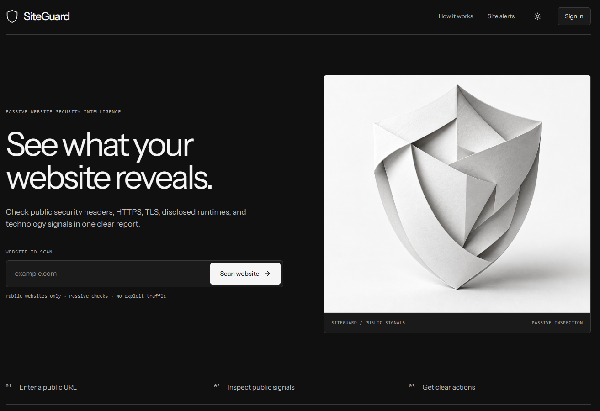

# SiteGuard



SiteGuard is an open source, passive website security scanner built with Laravel 13, Inertia 3, and Vue 3. Enter a public URL to inspect its HTTPS setup, TLS certificate, security headers, cookies, and visible software clues. Reports explain what each finding means. SiteGuard can also email verified site owners when someone scans their domain.

A public scan shows observable configuration; it cannot prove that a site is free of vulnerabilities. SiteGuard does not try to exploit a target.

## Requirements

- PHP 8.4 with the cURL, OpenSSL, mbstring, and PDO SQLite extensions (or the driver for your chosen database)
- Composer
- Node.js and npm
- SQLite, or another database supported by the Laravel configuration

## Local setup

1. Clone this repository and enter its directory.
2. Install the PHP and JavaScript dependencies:

   ```sh
   composer install
   npm ci
   ```

3. Copy `.env.example` to `.env`. On macOS or Linux, run `cp .env.example .env`; in PowerShell, run `Copy-Item .env.example .env`. Set `APP_URL` to the URL you will use locally.
4. Create an empty `database/database.sqlite` file for the default SQLite connection (`touch database/database.sqlite` on macOS or Linux, or `New-Item database/database.sqlite -ItemType File` in PowerShell). If you use another database, set its `DB_*` values in `.env` instead. Then initialize the application and build its assets:

   ```sh
   php artisan key:generate
   php artisan migrate
   npm run build
   ```

5. Point your local web server at `public/`. With Laravel Herd, the project is available at `https://site-scan.test` when linked as `site-scan`; set `APP_URL=https://site-scan.test` in `.env`. If you use the project's development command instead, run `composer run dev` and use the URL it prints.

Register an account in the app to see your scan history. For local email verification, the default `MAIL_MAILER=log` writes messages to `storage/logs/laravel.log`. To access the admin dashboard, verify your account and run:

```sh
php artisan siteguard:make-admin you@example.com
```

The dashboard is at `/admin`. To test site owner alerts or contact notifications, configure a real mail transport and run `php artisan queue:work --tries=3` in a separate terminal. The default log mailer does not deliver email.

## What it does

- Checks HTTPS, TLS certificates, security headers, cookies, CORS, cross-origin isolation, and visible software disclosure.
- Explains findings without displaying cookie values.
- Saves scan history for signed-in users and provides an admin dashboard.
- Lets verified users prove domain ownership with a DNS TXT record and receive scan alerts.
- Accepts contact requests through the site.

## Documentation

- [Implementation and scanner behavior](docs/architecture.md)
- [Development and tests](docs/development.md)
- [Production deployment](docs/deployment.md)

## License

The project declares the MIT license in `composer.json`.
